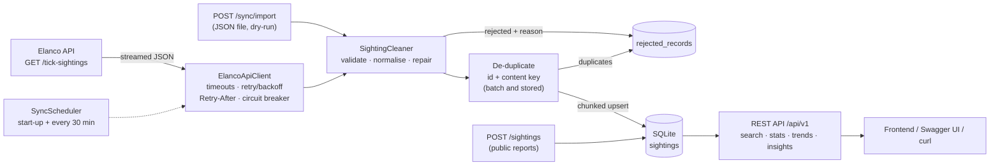

# UK Tick Sightings Tracker: Backend MVP

**Elanco Placement Programme 2026: Technical Task (Backend)**

- **Author:** Abreeque Rauf Sahi, BSc Computer Science, Brunel University London (sahi.abreeque@gmail.com)
- **Repository:** https://github.com/Abreeque153/Elanco-Tick-Tracker
- **Video walkthrough:** ADD YOUTUBE LINK HERE

A Java 21 / Spring Boot service that pulls tick-sighting data from the Elanco API, cleans and
de-duplicates it, stores it in SQLite, and serves it through a REST API with search, filtering,
aggregate reporting and statistically tested insights. It is built so the API keeps working when
the upstream source is slow, rate-limited or down.

```
./mvnw spring-boot:run      # then open http://localhost:8080
```

---

## Contents
1. [Quick start](#1-quick-start)
2. [How each requirement is met](#2-how-each-requirement-is-met)
3. [Architecture](#3-architecture)
4. [API reference](#4-api-reference)
5. [Data handling: what I found and what I decided](#5-data-handling-what-i-found-and-what-i-decided)
6. [Error handling](#6-error-handling)
7. [Insights (AI/ML extension)](#7-insights-aiml-extension)
8. [Testing](#8-testing)
9. [Technology choices](#9-technology-choices)
10. [Project structure](#10-project-structure)
11. [What I would do with more time](#11-what-i-would-do-with-more-time)

---

## 1. Quick start

**Requirements:** JDK 21 or newer (tested on JDK 25). Nothing else: the Maven wrapper downloads
Maven, and SQLite is embedded.

```bash
git clone https://github.com/Abreeque153/Elanco-Tick-Tracker.git && cd Elanco-Tick-Tracker
./mvnw spring-boot:run          # Windows: mvnw.cmd spring-boot:run
```

On start-up the service syncs the full dataset from the Elanco API in the background (about a
second) and then re-syncs every 30 minutes.

| Open | What you get |
|---|---|
| http://localhost:8080 | Interactive API docs (Swagger UI); every endpoint can be tried in the browser |
| http://localhost:8080/api/v1/stats/summary | Dataset overview |
| http://localhost:8080/actuator/health | Health, including upstream freshness |

A scripted tour of the main endpoints, with curl: `sh docs/demo.sh`

**Other commands**
```bash
./mvnw test                     # 90+ unit and integration tests (no network needed)
./mvnw package                  # builds target/tick-tracker.jar
java -jar target/tick-tracker.jar
```

**Configuration** (all optional, as environment variables or in `application.yml`)

| Variable | Default | Purpose |
|---|---|---|
| `PORT` | `8080` | HTTP port |
| `TICKS_STORAGE_PATH` | `data/ticks.db` | SQLite file (created automatically) |
| `TICKS_UPSTREAM_BASE_URL` | `https://dev-task.elancoapps.com/data` | Source API |
| `TICKS_SYNC_INTERVAL` | `30m` | Background re-sync interval (`0s` disables it) |
| `TICKS_SYNC_STALE_AFTER` | `2h` | When responses start reporting `X-Data-Stale: true` |

---

## 2. How each requirement is met

| Brief | Implementation |
|---|---|
| **Consume and process data from the API** | Background sync streams `GET /tick-sightings` element by element (Jackson streaming), validates and repairs each record, de-duplicates, and upserts into SQLite in 500-record transactions. On start-up, then every 30 min, plus `POST /api/v1/sync`. |
| **Large datasets** | Streaming parse means memory does not grow with payload size; chunked transactions; indexed columns; paged results (max 500 per page). |
| **Duplicates** | Same id twice in a batch → `DUPLICATE_ID`. Same time, city and species under a different id (in the batch *or* already stored) → `DUPLICATE_CONTENT`. Re-syncing is idempotent: unchanged rows are only re-stamped. |
| **Incomplete data** | Repair what is safe (case, whitespace, city aliases, other date formats, Latin name from species or the reverse); reject what is not (no id, date, location or species; impossible or future dates; species contradicting its Latin name). Every rejection is stored with its reason and raw JSON. |
| **Search and filter by time range and location** | `GET /api/v1/sightings?from=&to=&city=&region=&species=` plus **radius search** `lat=&lon=&radiusKm=` ("ticks near me"). Case-insensitive, multi-value, paged, sortable. |
| **Sightings per region** | `GET /api/v1/stats/by-region` (ONS regions and nations), also `/by-city` and `/by-species`, all filterable. |
| **Trends over time (weekly or monthly)** | `GET /api/v1/stats/trends?interval=week\|month\|year&splitBy=region\|city\|species`. ISO weeks, zero-filled periods, ready to chart. |
| **AI/ML insights (extension)** | `GET /api/v1/insights`: seasonality (chi-square), long-term trend (OLS + t-test), city risk ranking, anomaly detection (Poisson + Bonferroni) and a forecast with 95% intervals. Each part is tested for significance before it is claimed. |
| **Better handling of API failures and inconsistencies** | Timeouts, retry with exponential backoff and jitter, `Retry-After` honoured on 429, circuit breaker, serve-from-store when upstream is down, freshness headers, partial-sync recovery, RFC 9457 problem-details errors. |
| **Extra: citizen contribution** | `POST /api/v1/sightings` lets the public report a sighting (validated, de-duplicated). The brief's purpose says users should "contribute to a growing database". |
| **Extra: auditability** | `GET /api/v1/data-quality` and `/data-quality/rejected`: what was rejected or repaired, and why. `POST /api/v1/sync/import?dryRun=true` runs any JSON file through the pipeline as a "what if". |

---

## 3. Architecture



**The key decision: ingest into a local store instead of proxying the API.** Every read is
served from SQLite, never from the upstream. That gives:
* **Speed:** filtering, counting and grouping happen in SQL with indexes. The upstream has no
  pagination or date filters, and latency reached ~5 s under load.
* **Resilience:** an upstream outage only delays the next refresh; users keep getting answers,
  with `X-Data-Last-Synced` and `X-Data-Stale` headers saying how fresh they are.
* **Clean data, once:** validation and de-duplication happen when data comes in, not on every
  request.

**Layers.** The core (domain, ingestion, storage, analytics) is plain Java with no Spring
annotations. Spring Boot is only at the edges (controllers, configuration, health), and
`config/AppConfig` wires the core together. That keeps the business logic unit-testable without
starting a server, and the framework replaceable.

More detail, including trade-offs and how this would scale, is in
[docs/ARCHITECTURE.md](docs/ARCHITECTURE.md).

---

## 4. API reference

All endpoints are under `/api/v1` and documented interactively at `/swagger-ui.html`.

| Method & path | Purpose |
|---|---|
| `GET /sightings` | Search. Filters: `from`, `to`, `city`, `region`, `species`, `lat`+`lon`+`radiusKm`. Paging: `page`, `size`, `sort=date,desc\|date,asc` |
| `GET /sightings/{id}` | One sighting |
| `POST /sightings` | Report a sighting `{"date","city","species"}` → `201` + `Location` |
| `GET /stats/summary` | Totals, date range, coverage, freshness |
| `GET /stats/by-region` · `/by-city` · `/by-species` | Counts and percentage share, filterable |
| `GET /stats/trends` | `interval=week\|month\|year`, `splitBy=region\|city\|species`, filterable |
| `GET /insights` | Seasonality, trend, risk areas, anomalies, forecast. `region`, `city`, `species`, `asOf`, `forecastMonths` |
| `GET /sync/status` · `/sync/runs` | Pipeline health and run history |
| `POST /sync` | Trigger a sync now (`202 Accepted`, runs in the background) |
| `POST /sync/import?dryRun=` | Run a JSON array through the pipeline |
| `GET /data-quality` · `/data-quality/rejected` | Rejections by reason, repairs, raw rejected records |
| `GET /reference/cities` · `/regions` · `/species` | Reference data, including city coordinates for maps |

**Input conventions**
* Dates: `2024-05-01`, `2024-05` or `2024-05-01T09:30:00`. A date-only or month-only `to` is
  inclusive.
* Text filters ignore case and whitespace (`city=london`); several values via repetition or commas
  (`city=London,Leeds`); species also match Latin names (`species=Ixodes canisuga`).

**Example** (real output from the live dataset)
```http
GET /api/v1/sightings?city=london&from=2020-01-01&size=1
X-Data-Last-Synced: 2026-11-01T21:02:12.388139Z
X-Data-Stale: false

{
  "items" : [ {
    "id" : "JIpX177KvaSfIj0TY7iR",
    "date" : "2024-09-28T07:08:08",
    "city" : "London",
    "region" : "London",
    "latitude" : 51.5072,
    "longitude" : -0.1276,
    "species" : "Fox/badger tick",
    "latinName" : "Ixodes canisuga",
    "source" : "ELANCO_API"
  } ],
  "page" : 0, "size" : 1, "totalItems" : 33, "totalPages" : 33
}
```

**Measured on the live API** (MacBook, JDK 25): application start 1.0 s; full sync of 1,000
records 0.64 s; re-sync with no changes 0.5 s; typical API response ~20 ms.

---

## 5. Data handling: what I found and what I decided

Before designing the pipeline I profiled the live API (1 November 2026):

| Finding | Consequence for the design |
|---|---|
| `GET /tick-sightings` returns **all 1,000 records in one ~140 KB array**; query params like `page`/`limit` are ignored | Stream-parse instead of buffering, so it scales to a much larger feed; do all filtering and paging locally |
| City and species endpoints are **exact, case-sensitive matches** (`london` returns nothing) | My filters are case-insensitive and normalise aliases (`Newcastle upon Tyne` → `Newcastle`) |
| The spec documents **429 "rate limit exceeded, wait a minute"** and **500** | Retry with backoff up to 60 s, honour `Retry-After`, circuit breaker |
| 30 concurrent requests all succeeded, but **latency rose to ~5 s** | Explicit connect and response timeouts; never call upstream on the request path |
| Data covers **14 cities, 5 species, Jan 2012 to Dec 2024**; ISO-8601 local times, no time zone | Times kept as UK local time; analysis anchored to the latest sighting, not today |
| The data was **clean that day** (no duplicate ids, nulls or blanks) | The pipeline is still fully defensive: the brief asks for it, and real feeds degrade. `docs/demo-dirty-batch.json` exercises every rule |

**Validation rules** (`ingest/SightingCleaner`):

| Situation | Outcome |
|---|---|
| Not a JSON object; missing id, date or location; no species *and* no Latin name | Rejected (`MALFORMED_RECORD`, `MISSING_*`) |
| Impossible date (31 Feb), before 1900, or more than a day in the future | Rejected (`INVALID_DATE`, `FUTURE_DATE`) |
| Species and Latin name refer to *different* known species | Rejected (`SPECIES_CONFLICT`). Guessing which is right would corrupt data |
| `" london "`, `LONDON`, `Newcastle upon Tyne`; `marsh TICK` | Repaired to the canonical name (`CITY_NORMALISED`, `SPECIES_NORMALISED`) |
| Only a species or only a Latin name | The other is filled from the catalogue (`LATIN_NAME_INFERRED`, `SPECIES_INFERRED`) |
| `14/08/2024 09:30`, `2024-08-14 09:30`, `2024-08-14`, `…Z`, epoch numbers | Parsed (UK day-first) and converted to UK local time (`DATE_REFORMATTED`, `DATE_WITHOUT_TIME`, `TIMEZONE_CONVERTED`) |
| City or species not in the catalogue | **Kept** and flagged (`UNKNOWN_CITY` → region "Unknown", `UNKNOWN_SPECIES`); new places shouldn't be silently dropped |

Try it: `POST /api/v1/sync/import?dryRun=true` with `docs/demo-dirty-batch.json` returns 4 accepted
(with their repairs) and 10 rejected, one for each rule.

---

## 6. Error handling

**Upstream (consuming the Elanco API)**

| Failure | Behaviour |
|---|---|
| Timeout, connection refused, 5xx | Retried up to 4 attempts with exponential backoff (1 s, 2 s, 4 s…) and jitter |
| 429 rate limit | Waits for `Retry-After` (seconds or HTTP date), capped at 60 s |
| Other 4xx | Not retried (retrying cannot help); logged and recorded |
| Body is not a JSON array (e.g. an HTML error page) | `MALFORMED_RESPONSE`; existing data untouched |
| Connection drops mid-stream | Records already read are committed; the run is marked `PARTIAL`; the next run completes it idempotently |
| 3 consecutive failed syncs | **Circuit breaker opens** for 2 min: syncs fail fast instead of hammering a broken service, then one trial call is allowed |
| App stops mid-sync | On restart the stale `RUNNING` run is marked `FAILED` |

Every run (trigger, status, counts, repairs, rejections, error) is recorded and visible at
`GET /api/v1/sync/runs`.

**Downstream (our API's clients)**
* All errors use **RFC 9457 problem details** (`application/problem+json`) with a clear `detail`,
  e.g. `'from' must be earlier than 'to'` or `Unknown region 'Narnia'. Valid regions: …`.
* Validation errors list each failing field. Unknown ids return 404, duplicates and concurrent
  syncs return 409.
* Unexpected exceptions return a generic 500. Stack traces and SQL are logged, never sent to
  clients.

---

## 7. Insights (AI/ML extension)

`GET /api/v1/insights`. I chose **explainable statistics over a black-box model**: with ~1,000
records spread over 14 cities and 13 years (under one sighting per city per month), a trained model
would mostly learn noise. A public-health tool that reports false patterns does harm, so every
insight is **tested before it is claimed**, and each section includes a plain-English
`interpretation`.

| Insight | Method |
|---|---|
| **Seasonality**: are some months busier? | Chi-square goodness-of-fit against a uniform rate, weighted by days per month (February has fewer days, so it should have fewer sightings) |
| **Long-term trend**: rising or falling? | Least-squares slope on monthly counts, t-test, direction reported only if \|t\| ≥ 1.96 |
| **Risk areas**: where is activity highest now? | Last 12 months per city vs the national average per city (HIGH ≥ 1.5×, LOW ≤ 0.5×), plus change on the previous 12 months |
| **Anomalies**: unusual spikes | Poisson tail probability per city-month, with a **Bonferroni correction** for the ~2,000 comparisons (otherwise about 20 false alarms would appear by chance) |
| **Forecast**: next N months | Recent level, multiplied by trend and seasonal factors **only if those were significant**; 95% Poisson interval |

**On the real data** the service reports *no significant seasonality (chi-square p = 0.43), no
significant trend (t = 0.05) and no anomalous spikes* after the Bonferroni correction. The dataset appears to be uniformly random. Saying so is the
correct, honest output, and the tests prove the same code **does** detect genuine seasonality,
trends and spikes in synthetic data.

---

## 8. Testing

```bash
./mvnw test
```

| Suite | What it proves |
|---|---|
| `SightingCleanerTest` | Every validation and repair rule |
| `ElancoApiClientTest` | Retries and backoff, `Retry-After`, no retry on 4xx, timeouts, truncated or invalid payloads, connection failures, circuit breaker opening and recovering (against a scriptable fake HTTP server) |
| `SyncServiceTest` | End to end on a messy feed: exact counts per rejection reason, idempotent re-sync, updates, duplicate-of-stored detection, outage keeps data, partial-stream recovery, dry-run writes nothing |
| `SightingRepositoryTest`, `QueryParserTest` | Inclusive date ranges, case-insensitive and multi-value filters, radius search, paging, sorting, input validation |
| `TrendServiceTest` | Zero-filled months, ISO weeks (30 Dec 2024 = 2025-W01), splits, range guard |
| `StatsTest` | Chi-square, Poisson and regression against textbook critical values |
| `InsightsServiceTest` | Detects real seasonality and spikes in synthetic data, and does **not** invent them in uniform data |
| `ApiIntegrationTest` | Full Spring context over HTTP: status codes, problem details, headers, validation, docs and health endpoints |

Tests use a temporary SQLite file and a local fake upstream, so they need no network.

---

## 9. Technology choices

| Choice | Why |
|---|---|
| **Java 21 + Spring Boot 3.5** | Industry standard for enterprise backends; records, pattern matching and text blocks keep the code concise |
| **SQLite** (via plain JDBC) | Zero setup for reviewers, a real SQL engine with indexes, and WAL mode lets reads continue during a sync. Plain JDBC keeps every query visible, which suits an aggregation-heavy schema |
| **`java.net.http.HttpClient` + Jackson streaming** | Built-in, supports timeouts and streaming bodies; no extra HTTP dependency |
| **Hand-written retry and circuit breaker** | ~150 lines I can explain line by line; in production I'd use Resilience4j |
| **springdoc-openapi** | Interactive docs generated from the code, so they cannot drift out of date |
| **JUnit 5 + JDK `HttpServer` fake** | Tests failure modes (429, 500, timeouts, broken streams) that are impossible to trigger on demand against the real API |

---

## 10. Project structure

```
src/main/java/com/ticktracker
├── domain/      Sighting, Catalogue (cities→regions→coordinates, species↔Latin names), Text
├── ingest/      ElancoApiClient, RetryPolicy, CircuitBreaker, JsonArrayReader,
│                SightingCleaner, SyncService, SyncScheduler, run and rejection repositories
├── store/       Database (schema, transactions), SightingRepository, SightingQuery
├── query/       QueryParser: turns query strings into validated filters
├── analytics/   TrendService, InsightsService, Stats
├── reports/     ReportService: public sighting reports
├── api/         REST controllers, problem-details handler, freshness filter, CORS
├── config/      AppConfig (wiring), TicksProperties, OpenApiConfig
└── health/      Upstream health indicator
src/main/resources/  application.yml, schema.sql
docs/                ARCHITECTURE.md, VIDEO_SCRIPT.md, demo.sh, demo-dirty-batch.json
```

---

## 11. What I would do with more time

* **Incremental sync:** ask Elanco for an `updatedSince` or ETag on `/tick-sightings` so each sync
  fetches only changes; detect records deleted upstream (the schema already tracks `last_seen_at`).
* **PostgreSQL + PostGIS** for multi-instance deployments and true geospatial queries
  (postcode-level points instead of city centroids), with **Flyway** migrations.
* **Population and habitat normalisation** for risk scores (sightings per 100k people, woodland
  cover), and weather features (temperature, humidity) for a genuinely predictive model once
  there is enough real data.
* **Security for writes:** authentication or rate limiting on `POST /sightings` and the sync
  endpoints, plus moderation of public reports.
* **Observability:** Micrometer metrics (sync duration, rejection rates) and alerting when data
  goes stale.
* **Containerisation:** a Dockerfile and CI pipeline (GitHub Actions running `./mvnw verify`).
* A small **map frontend** consuming `/sightings` and `/reference/cities` (coordinates are already
  in every response).
