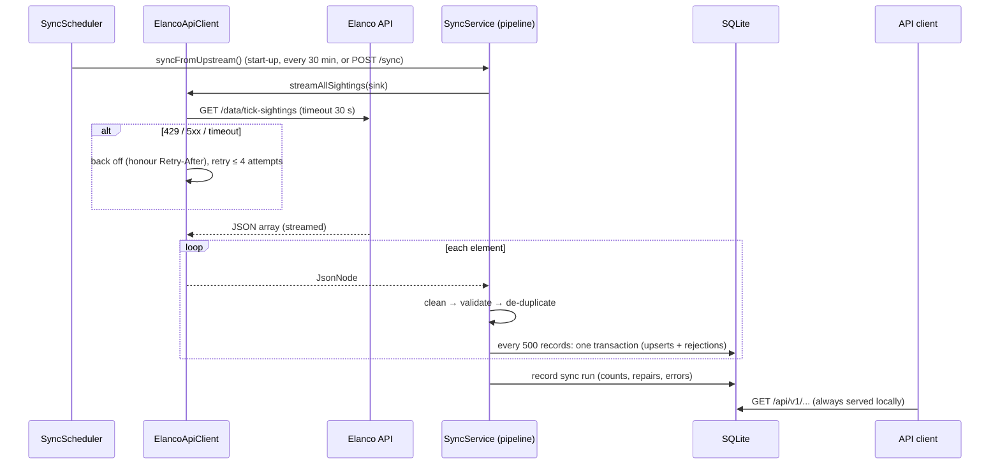

# Architecture and Design Decisions

This document covers the architecture decisions, how the system consumes and presents data, and
what I would improve. The brief lists these as the optional write-up.

## 1. System overview

The request path (users calling `/api/v1/...`) and the ingestion path (syncing from Elanco) are
**fully decoupled**: reads never wait for the upstream, and an upstream failure never becomes a user-facing error.

## 2. Decisions and trade-offs

### D1. Ingest into a store rather than proxy the upstream
* **Context:** the upstream has no pagination, date filters or aggregation; its city and species
  lookups are case-sensitive; latency reached ~5 s under concurrent load; it documents rate
  limiting.
* **Decision:** periodically copy the whole dataset into SQLite and serve every request from there.
* **Trade-off:** data can be up to one sync interval old (30 min by default). This is made explicit
  through `X-Data-Last-Synced` / `X-Data-Stale` headers and `/sync/status`. For sighting data that
  changes slowly, freshness measured in minutes is acceptable; availability and speed matter more.

### D2. SQLite with plain JDBC
* **Why SQLite:** zero setup for anyone running the project, a real SQL engine (indexes,
  `GROUP BY`, UPSERT), and WAL mode so reads continue while a sync writes. `busy_timeout` avoids
  `SQLITE_BUSY` under concurrent writes.
* **Why plain JDBC:** the workload is mostly aggregation (`COUNT … GROUP BY`) over a single table,
  which is clearer in SQL than through an ORM. All values are bound parameters; the only
  concatenated parts are column names from a fixed enum (`Dimension`), so there is no injection
  risk.
* **Limit:** one writer at a time and one node. The `Database` and repository classes are the
  only code touching SQL, so moving to PostgreSQL means changing the driver and a few
  SQLite-specific functions (`substr` for day bucketing, `ON CONFLICT`).

### D3. Stream the payload, write in chunks
* `JsonArrayReader` uses Jackson's streaming parser: memory holds one record at a time, not the
  whole array. 1,000 records ≈ 140 KB today, but the design copes with a 100× larger feed.
* Records are processed and committed 500 at a time. A failure mid-stream keeps the committed
  chunks (status `PARTIAL`), and because upserts are idempotent the next run simply completes the
  job.
* Retrying is only done *before* records start flowing. Retrying mid-stream would replay records
  already processed.

### D4. Repair what is safe, reject what is not, and record both
* Rejecting every imperfect record throws away real sightings (e.g. `" london "`); accepting
  everything corrupts statistics. The cleaner repairs only when the right answer is unambiguous,
  and records a `Repair` tag every time.
* Ambiguous cases are rejected, not guessed: when a species and its Latin name disagree, which one
  is wrong is unknowable.
* Unknown cities and species are **kept** (region "Unknown"), so a new location in the feed is
  visible rather than silently lost.
* Rejected records are stored once each (SHA-256 fingerprint) with their raw JSON, reason and a
  `times_seen` counter, so a recurring upstream defect is visible without the table growing on
  every sync.

### D5. Two levels of de-duplication
1. **Identity:** the same `id` twice in a batch (first one wins).
2. **Content:** same timestamp, city and species under a *different* id, in the batch or already
   stored (`content_key` has a `UNIQUE` index). This catches the classic double-submission
   problem with crowdsourced data.

Re-syncs compare each incoming record with its stored version and classify it as
inserted / updated / unchanged, so a sync with no changes writes almost nothing.

### D6. Resilience patterns for the upstream
| Pattern | Purpose |
|---|---|
| Connect timeout 5 s, response timeout 30 s | Never hang on a slow upstream |
| Exponential backoff with jitter | Recover from transient failures without synchronised retry storms |
| `Retry-After` support | Respect the documented 429 rate limit |
| Classified errors (`UpstreamException.Kind`) | Retry only what retrying can fix (not 404, not malformed JSON) |
| Circuit breaker | After 3 failed syncs, pause calls for 2 min, then allow one trial call |
| Single-threaded scheduler | Syncs never overlap; manual triggers return 202 and run in the background |
| Start-up recovery | Runs cut off by a shutdown are marked `FAILED` |

### D7. Framework at the edges
Domain, ingestion, storage and analytics are plain Java with no Spring annotations, wired in
`AppConfig`. Benefits: unit tests construct real objects directly (fast, no mocks), and the core
logic would work unchanged behind a different framework or a CLI.

### D8. Statistics over black-box ML for the extension
At about 0.5 sightings per city per month, a trained model would mostly fit noise. The insights
endpoint uses classical tests (chi-square, t-test, Poisson + Bonferroni) and states only what is
statistically supported, in plain English. On the live data it reports no seasonality, no trend
and no anomalies. That matches the data, which appears uniformly random, and synthetic-data tests
show the same code does detect real patterns.

## 3. How the system presents data

* **REST/JSON** under `/api/v1`, documented with OpenAPI at `/swagger-ui.html` (the root URL
  redirects there).
* **Search responses** are paged (`items`, `page`, `size`, `totalItems`, `totalPages`). Each
  sighting includes its region and city coordinates, so a map client needs no second lookup.
* **Trend responses** are chart-ready: ordered, zero-filled points with both a label
  (`2024-W05`, `2024-05`) and a start date.
* **Stats responses** include each group's percentage share.
* **Freshness** is on every response (`X-Data-Last-Synced`, `X-Data-Stale`). Pipeline state is at
  `/sync/status`, data quality at `/data-quality`, and health (including upstream state) at
  `/actuator/health`.
* **Errors** are RFC 9457 problem details with actionable messages.
* **CORS** is enabled on `/api/**`, so a browser frontend on another origin can call it directly.

## 4. Scaling path

| Scale | Change |
|---|---|
| ~10⁵ records, one instance | Current design (indexes, streaming, chunked writes) |
| Multiple instances | PostgreSQL (+ PostGIS), Flyway migrations, sync run by a single scheduled job (or leader election) rather than every instance |
| Millions of records or frequent updates | Incremental sync (`updatedSince` / ETag from upstream), keyset pagination instead of `OFFSET`, pre-aggregated monthly tables refreshed per sync |
| Real-time public reports | Queue (e.g. SQS/Kafka) between `POST /sightings` and storage, plus moderation |

## 5. Known limitations

* Locations are city-level, so a radius search uses city centres. Proper point data (lat/lon per
  sighting) would allow precise geospatial queries.
* Dates are interpreted as UK local time, and ambiguous numeric dates as UK day-first
  (`03/04/2024` = 3 April).
* Records deleted upstream are not removed locally (`last_seen_at` makes this easy to add).
* Write endpoints (`POST /sightings`, `/sync`, `/sync/import`) have no authentication. That is
  fine for an MVP demo, but must change before any public deployment.
